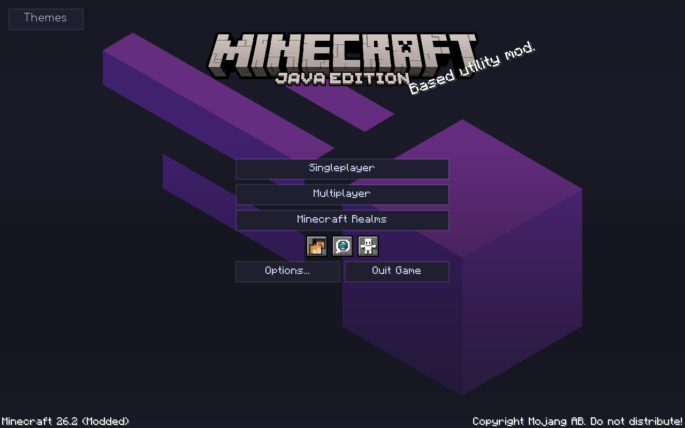
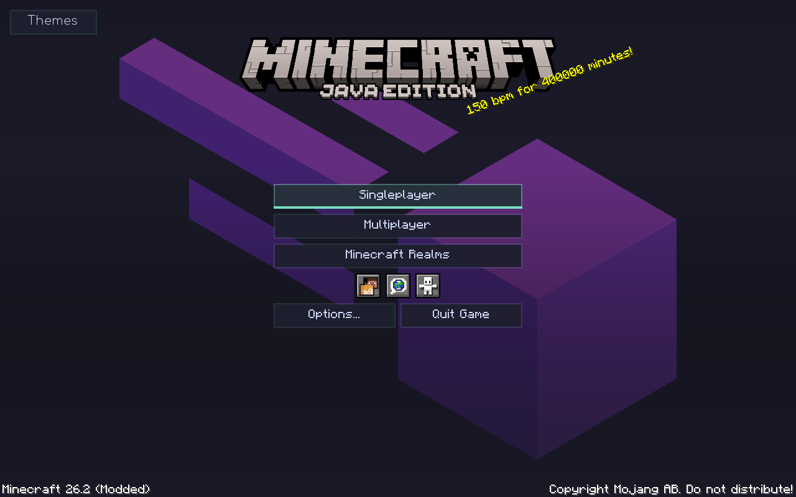
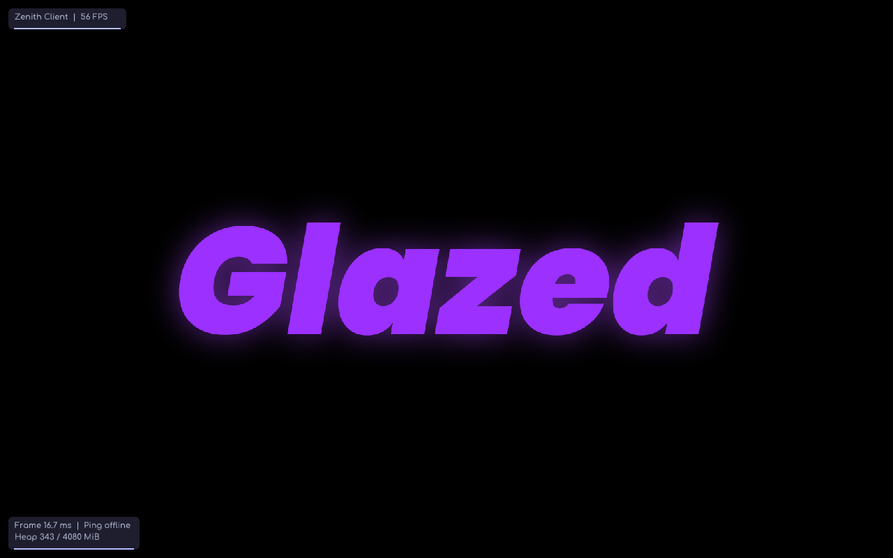

# Meteor Purple Edition · Zenith HUD

Minecraft's familiar main menu, with a static purple Meteor mark replacing the panorama. The real vanilla buttons, world selection, Realms, multiplayer checks, language/accessibility controls, narration and addon hooks are preserved. A small Themes button opens the live palette gallery. The optional addon-credit overlay can be enabled with menu-addon-credits; it is hidden by default on this menu. Hover or keyboard focus reveals an accent underline with one short shine; it stops when settled.

The client UI stays classic: **Right Shift** opens the normal Meteor/Catppuccin category windows. There is no unified hub or alternate layout selector.

## Download and install

[Download v1.2.0](https://github.com/davyduao-hue/Meteor-Purple-Edition/releases/tag/v1.2.0). Use **meteor-purple-edition-1.2.0.jar**, replacing your previous Purple Edition JAR in your instance's `mods` folder.

Requires **Minecraft Java 26.2**, **Java 25** and **Fabric Loader 0.19.3+**. Meteor 26.2-35, Catppuccin 2.4.0+mc26.2 and Fabric API 0.154.2+26.2 are already included. Remove duplicate standalone copies of those three mods.

## Appearance and performance

Open **Purple → Purple Appearance** in the classic UI. Choose Mocha, Purple Glass, Minimal Lavender, OS26 Glass, Midnight, Rose Quartz, Ocean, Forest, AMOLED Violet or Original Meteor. Palettes use quieter surface tints and stronger secondary text. Enable **custom-accent** and choose **accent-color** for the underline, panels and HUD edges; body text retains its readable theme color. Original uses Meteor's own classic widgets; the custom accent still applies to the menu and HUD.

Blur and window shadows are **off by default**. Glass transparency does not require blur. Optional adaptive blur suspends the blur pass at low FPS. Performance mode disables animations, blur and shadows, makes panels opaque, and refreshes HUD data twice per second instead of four times. Reduced motion removes transitions without changing the palette. No system services, registry settings, drivers, security tools or global Windows settings are changed.

The menu draws seven cached logo faces and fills instead of a rotating panorama. Hover shine runs once per entry. HUD frame sampling only adds two numbers per rendered frame; string formatting, heap reads and text measurements run at the bounded HUD refresh rate. There are no HUD blur passes, polling threads or background network requests from Purple Edition.

## Zenith HUD

Two bars are added once after settings load:

- **Zenith Client**: a floating top-left brand bar, with optional FPS.
- **Zenith Performance**: bottom-left frame interval, connection ping and used/max JVM heap. Frame interval is measured from rendered frames; heap is Java heap, not total PC RAM.

Open Meteor's **HUD editor** to move, resize, toggle or remove either bar. Right-click an element to edit scale, background, opacity, theme synchronization and colors. Metrics can be toggled individually. The bottom bar uses Meteor's bottom anchor and remains attached to that edge after resizing. Existing elements and edited positions are retained. Deleted bars are not re-created on every launch; **Add Zenith HUD bars** restores only missing bars. The previous `purple-watermark` ID is retained so saved layouts migrate to the Zenith label.

The other optional Purple elements (FPS, ping, coordinates, modules, armor, effects, memory and server) remain in Meteor's HUD catalog. They are not all added automatically.

## Optional addons

Use official **26.2** releases. Glazed and OpSec are separate installs; do not add a second ExploitPreventer when Glazed already supplies it.

| Combination | Validation |
| --- | --- |
| Purple bundle alone | Build and automated runtime smoke test |
| Purple + Glazed 17.2 + its ExploitPreventer 1.1.0 + OpSec 1.1.7.1 | Runtime test checks initialization, classic UI, OpSec's EP compatibility flag and official settings screen |

OpSec 1.1.7.1 detects EP and defers its overlapping protections to EP while preserving saved preferences and its remaining features. Fabric still prints OpSec's upstream `conflicts` metadata warning. Purple does not suppress the warning, strip a mod, bypass protection, or alter either protection engine. **Purple Privacy** displays installed addon status and the detected compatibility mode. This is startup/UI interoperability testing, not a claim of comprehensive live-server protection testing.

Official sources: [Glazed](https://github.com/realnnpg/Glazed/releases), [OpSec](https://github.com/aurickk/OpSec/releases), [ExploitPreventer](https://github.com/NikOverflow/ExploitPreventer). Glazed's license prevents bundling it. See [THIRD_PARTY.md](THIRD_PARTY.md) for exact bundled source revisions and licenses.

## Build and validation

Run `gradlew.bat build` (Windows) or `bash gradlew build` (Linux), then `python scripts/verify_bundle.py`. Artifacts are in `build/libs/`. Releases include the binary, addon sources and a complete corresponding-source archive with pinned Meteor/Catppuccin sources. GitHub Actions builds and tests on Windows and Linux before publishing.

See [VALIDATION.md](VALIDATION.md) for evidence and limits. No live-server exploit tests or controlled gameplay FPS comparison have been performed.

## Actual screenshots

