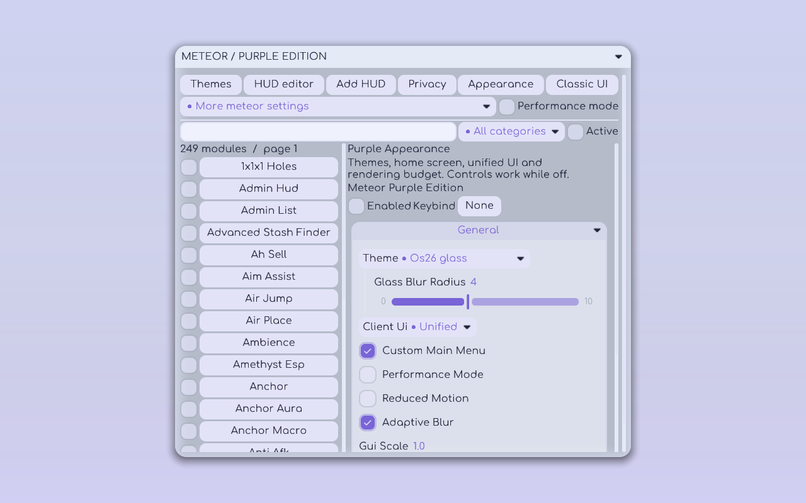
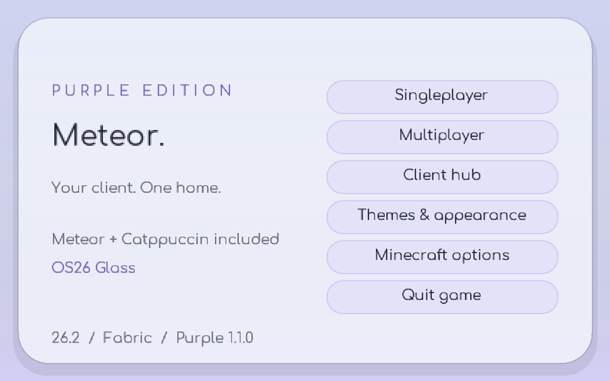
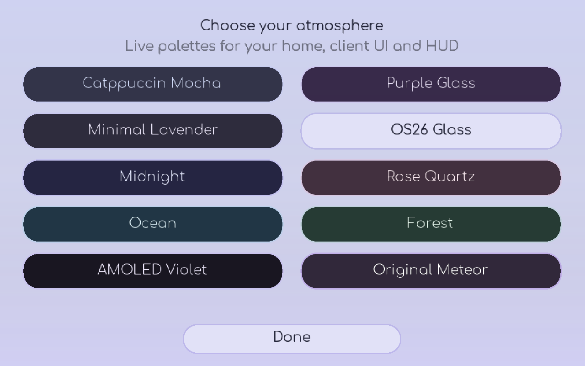

# Meteor Purple Edition 1.1

**One JAR. Meteor + Catppuccin + Fabric API included.** A coordinated Minecraft **26.2** client setup with ten themes, a custom home screen, a searchable unified client UI and a configurable HUD. This is an independent GPL-3.0 project, not an official upstream release.



## Install

1. Install **Minecraft 26.2**, **Java 25** and **Fabric Loader 0.19.3 or later**.
2. Download **`meteor-purple-edition-1.1.0.jar`** from [Releases](https://github.com/davyduao-hue/Meteor-Purple-Edition/releases/tag/v1.1.0).
3. Put that JAR in your instance's `mods` directory. Meteor **26.2-35**, Catppuccin **2.4.0+mc26.2** and Fabric API **0.154.2+26.2** are inside it. Remove the older Purple Edition JAR and separate copies of these included mods to keep the installation unambiguous.
4. Launch Fabric. Use **Client hub** on the new home screen, or press **Right Shift**.

Existing Meteor settings and profiles remain in their normal configuration files. The original three preset identifiers are retained for upgrades. New installations default to OS26 Glass; existing installations retain their saved theme selection.

## A home for the client

The custom menu provides Singleplayer, Multiplayer, Client hub, Themes, Minecraft options and Quit. It follows the selected palette, with smooth Comfortaa typography, rounded surfaces, subtle highlight transitions and a static gradient background. Keyboard navigation and button narration use Minecraft's native button behavior.



Disable **Custom Main Menu** under Purple Appearance to restore Minecraft's title screen. This setting is independent of the Classic/Unified client UI choice.

## Unified or Classic UI

**Unified** brings module search, categories, active-module filtering, inline toggles, descriptions, settings and keybind editing into one window. Select a module to edit it alongside the module list. Color pickers, sliders, conditional settings and custom addon widgets use the actual Meteor/Catppuccin APIs. Search covers names, descriptions, categories and addon names.

The toolbar opens the theme gallery, HUD editor, appearance settings and optional privacy controls. **More Meteor settings** preserves access to Meteor's normal tabs, including profiles, macros, friends and configuration. The full original module screen is still available for every module.

**Classic** restores movable category windows. Choose it in Purple Appearance's **Client UI** setting, or press the Classic UI button in the hub. Choose **Original Meteor** as the theme to use Meteor's original theme widgets. Neither option requires restarting the game.

## Ten live themes



| Theme | Appearance |
| --- | --- |
| OS26 Glass | Pearl and lilac surfaces, rounded floating panels, native background blur and gentle highlights. An OS26-inspired interpretation, not a pixel-identical replica. |
| Catppuccin Mocha | Improved charcoal/lavender palette, softer shadows and restrained transitions. |
| Purple Glass | Plum-tinted translucent panels, purple highlights and native background blur. |
| Minimal Lavender | Compact layout, small corners, immediate transitions and reduced effects. |
| Midnight | Deep indigo with electric violet. |
| Rose Quartz | Warm plum and soft rose. |
| Ocean | Deep navy and glacial blue. |
| Forest | Evergreen and mint. |
| AMOLED Violet | Black surfaces, violet accents and no shadows. |
| Original Meteor | Original Meteor theme and palette. |

All presets synchronize the custom menu and Purple HUD. Scale, opacity, animation duration and glass blur radius are configurable. Glass uses Minecraft's existing full-screen background blur, not a separate blur pass for each panel. The presets extend the real Catppuccin addon, which remains included and credited.

## Performance work

- HUD text measurements and element bounds are cached between data refreshes, instead of being recalculated every frame. Palette colors and rounded-corner geometry are also cached.
- Normal HUD data refreshes at 4 Hz; Performance mode reduces it to 2 Hz, bypasses blur and shadows, removes transitions, makes panels opaque and avoids gradient HUD drawing.
- Adaptive blur samples FPS once per second, suspends blur below 45 FPS and restores it at 60 FPS. The different thresholds prevent rapid switching around one boundary.
- Module search is computed when filters change; module lists are paged in groups of 32. Active-module events update visible toggles without rebuilding the entire UI.
- Reduced Motion disables transitions while retaining the chosen palette and transparency.

These changes reduce work done by Purple Edition's UI/HUD. They are not a claim of a measured gameplay FPS increase or a replacement for a general rendering optimizer.

## HUD

Use **Add HUD**, then **HUD editor**. Existing elements are preserved; adding the layout again does not create duplicate Purple elements. Nine movable panels provide watermark, FPS, latency, coordinates, active modules, armor durability, potion timers, memory usage and server name. Each supports scaling, opacity, custom colors and theme synchronization. The initial layout wraps into a second column when space permits.

## Glazed and OpSec

[Official Glazed v17.2](https://github.com/realnnpg/glazed/releases/tag/v17.2) can be installed separately using **`glazed-26.2-n-17.2.jar`**. The unified UI discovers its modules automatically. An isolated runtime test loaded **249 modules with Glazed**, compared with **169 in the base bundle**, and rendered every theme. This does not establish that every Glazed feature works on every server. Install any additional dependencies required by the specific Glazed features you use.

Glazed is **not bundled**: its [All Rights Reserved license](https://github.com/realnnpg/glazed/blob/1.21.11/LICENSE) prohibits redistribution and incorporation into distributed software. No Glazed code or binary is copied into this project or its releases.

[Original OpSec](https://www.curseforge.com/minecraft/mc-mods/opsec) is an optional separate installation (`opsec-26.2+v1.1.7.1.jar`). The Privacy panel reports selected protection status, opens the full official settings screen and saves notification changes through OpSec's own configuration manager. It does not replace the protection engine or access saved account tokens.

**Known upstream conflict:** Glazed bundles ExploitPreventer 1.1.0, which OpSec 1.1.7.1 explicitly marks as conflicting. The Glazed runtime test for this release omitted OpSec. Purple Edition reports the conflict when both are present and does not silently remove either mod or disable protections.

## Build and verification

With a Java 25 JDK, run:

```bat
gradlew.bat build
```

Linux/macOS: `bash ./gradlew build`. The included checksum-pinned Gradle 9.7.1 wrapper uses Fabric Loom 1.17.11 and the unobfuscated Minecraft 26.2 APIs. No Minecraft game files are redistributed.

Outputs under `build/libs/`:

```text
meteor-purple-edition-1.1.0.jar
meteor-purple-edition-1.1.0-sources.jar
meteor-purple-edition-1.1.0-corresponding-sources.zip
```

The corresponding-source ZIP contains Purple Edition's complete source/build files and the exact Meteor/Catppuccin source archives, including upstream build scripts and assets. Their SHA-256 hashes are checked during the build. See [THIRD_PARTY.md](THIRD_PARTY.md) for revisions and licenses.

`scripts/verify_bundle.py` verifies the actual nested mod IDs/versions. JUnit checks body-text contrast across all palettes. GitHub Actions validates the wrapper, runs the build/tests on Windows and Linux, verifies the bundle, uploads artifacts and publishes marked releases with corresponding sources.

An isolated game test is provided in `qa/bundle-smoke`. Build the main project first, then run `..\..\gradlew.bat runClient -x downloadAssets` from that directory (Linux: `bash ../../gradlew runClient -x downloadAssets`). It opens a separate development client, cycles all themes, checks search and menu/UI routing, captures actual render frames and exits. A complete Minecraft asset cache is needed; omit `-x downloadAssets` to download it. The test uses no real account token. See [VALIDATION.md](VALIDATION.md) for observed results and their limits.

## Credits and limitations

[Meteor Development](https://github.com/MeteorDevelopment/meteor-client) supplies the framework; [Pindour / X-C-0](https://github.com/X-C-0/catppuccin-addon) supplies the real Catppuccin theme and rounded widget renderer. [Catppuccin](https://catppuccin.com/) supplies the original Mocha palette. [Fabric](https://fabricmc.net/), Gradle and the Comfortaa font project are credited in THIRD_PARTY.md.

The release targets exactly **Minecraft 26.2**. It remains a prerelease: UI/bundle rendering has been tested, but live multiplayer, every upstream module, controller/accessibility behavior and performance on other GPUs have not been certified. The three-dimensional world and underlying Meteor/Glazed module behavior remain upstream functionality. Purple Edition's source is GPL-3.0-only; bundled components retain their own licenses.
