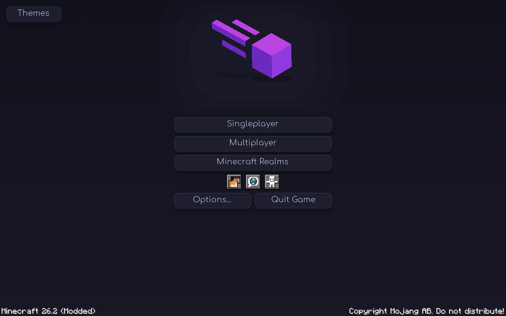
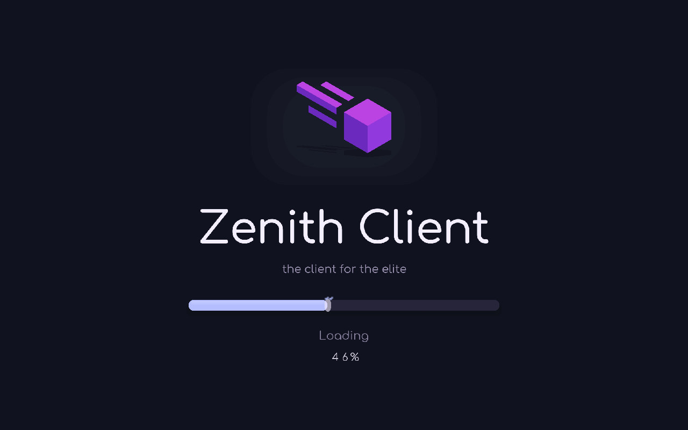

# Meteor Purple Edition v1.4.0 · Zenith

A clean Meteor-logo main menu with rounded typography, springy button feedback and a matching animated Zenith loading screen. Minecraft's real menu actions, narration, world selection, multiplayer/Realms checks, friends, language and accessibility controls remain intact. The client UI stays classic: Right Shift opens normal Meteor/Catppuccin category windows.

## Download

[Download v1.4.0](https://github.com/davyduao-hue/Meteor-Purple-Edition/releases/tag/v1.4.0). Replace the previous Purple Edition JAR with **meteor-purple-edition-1.4.0.jar** in your instance's mods folder.

Requires Minecraft Java **26.2**, Java **25** and Fabric Loader **0.19.3+**. Meteor 26.2-35, Catppuccin 2.4.0+mc26.2 and Fabric API 0.154.2+26.2 are bundled; remove duplicate standalone copies of those three mods.

## Menu and loading

The **Meteor backdrop is the default**, including upgrades from v1.3.0. It has a floating purple Meteor mark with a grounded shadow, restrained cursor-follow movement, staggered button entrances, springy hover lift, click compression, rounded surfaces and a short sheen. The large Minecraft wordmark and promotional splash are hidden on this custom menu. Disable custom-main-menu to use Minecraft's normal menu.

The colosseum is optional: open **Themes** and choose **Colosseum backdrop**, or change **Purple → Purple Appearance → menu-background**. Choose **Meteor backdrop** to return. The optional cubemap is loaded only when selected and released when switching back; the default logo menu does not load the extra 24 MiB colosseum GPU image. The six panorama images remain packaged for offline use. [Panorama source and capture tools](tools/panorama-studio) document the real Minecraft/shader capture.

Both resource loading and world loading use **Zenith Client** and **the client for the elite**, in smooth Comfortaa typography. The new pill-shaped loading bar follows actual native progress through a bounded spring, with a bright end cap, gloss and six small spark particles on progress advances. The logo has a soft entrance and gentle float. Percentages come from the real native progress value. There are no artificial minimum loading durations or completion delays. Native reload, errors, world readiness, fades and narration still control the lifecycle.

A small pre-rendered Comfortaa type atlas is registered directly from the addon during bootstrap, so the custom font works on the very first resource load without relying on Minecraft's font reload being complete. The atlas generation script and original OFL font are included.

## Motion controls

Open **Purple → Purple Appearance**:

- **ui-animations**: menu, gallery and loading motion; on by default.
- **in-game-animations**: optional Zenith HUD entrance/value glints and springy Minecraft pause/options buttons in a world; off by default.
- **reduced-motion**: turns off both kinds of motion while keeping the appearance.
- **performance-mode**: disables motion, particles, blur and shadows, makes panels opaque, freezes the optional panorama and lowers HUD data refresh from 4 Hz to 2 Hz.

In-game feedback does not shake the camera, move the player, alter hitboxes, change physics or delay actions. HUD editor positions stay stable. A tiny namespaced motion preference file in the instance's config folder preserves accessibility choices before Meteor initializes. It is read once during bootstrap and written only when motion settings change.

## Themes and HUD

Ten live themes remain: Mocha, Purple Glass, Minimal Lavender, OS26 Glass, Midnight, Rose Quartz, Ocean, Forest, AMOLED Violet and Original Meteor. Custom accent color changes hover/selection feedback, HUD edges and loading bar color. Minimal and AMOLED suppress motion as part of their low-effect style. Blur and window shadows remain off by default.

Meteor's HUD editor lets you move, scale, disable or remove the **Zenith Client/FPS** bar and **Zenith Performance** panel (actual average frame interval, ping and Java heap). Each metric can be toggled. Existing layouts and positions are retained. Optional legacy Purple HUD elements remain in the catalog.

## Optional addons and validation

Glazed and OpSec remain separate official 26.2 installs; Glazed includes ExploitPreventer, so avoid adding a duplicate copy. Tests cover the standalone bundle and Glazed 17.2 + ExploitPreventer 1.1.0 + OpSec 1.1.7.1. OpSec's official EP compatibility mode is detected without changing either protection engine. Its upstream Fabric conflict warning remains. See [THIRD_PARTY.md](THIRD_PARTY.md) for source/license details and official links.

Run `gradlew.bat build` or `bash gradlew build`, followed by `python scripts/verify_bundle.py`. Build artifacts and complete corresponding sources are in build/libs. GitHub Actions builds on Windows and Linux before publishing. [VALIDATION.md](VALIDATION.md) records the tests and limits. No controlled FPS-gain claim or live-server protection certification is made. No global Windows settings or normal launcher profile was modified.

## Actual in-game screenshots

