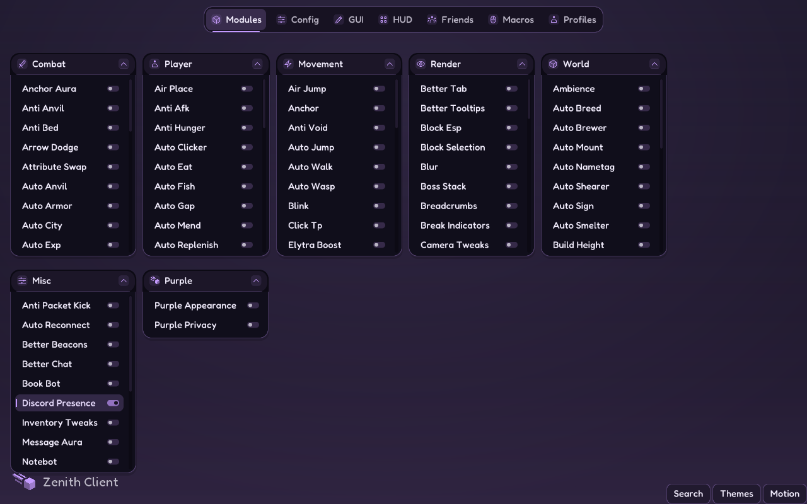
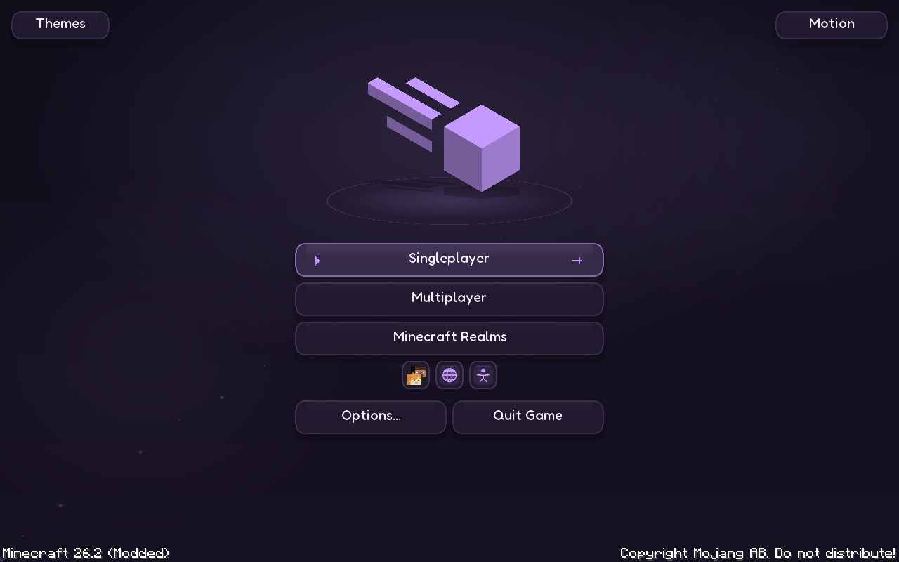
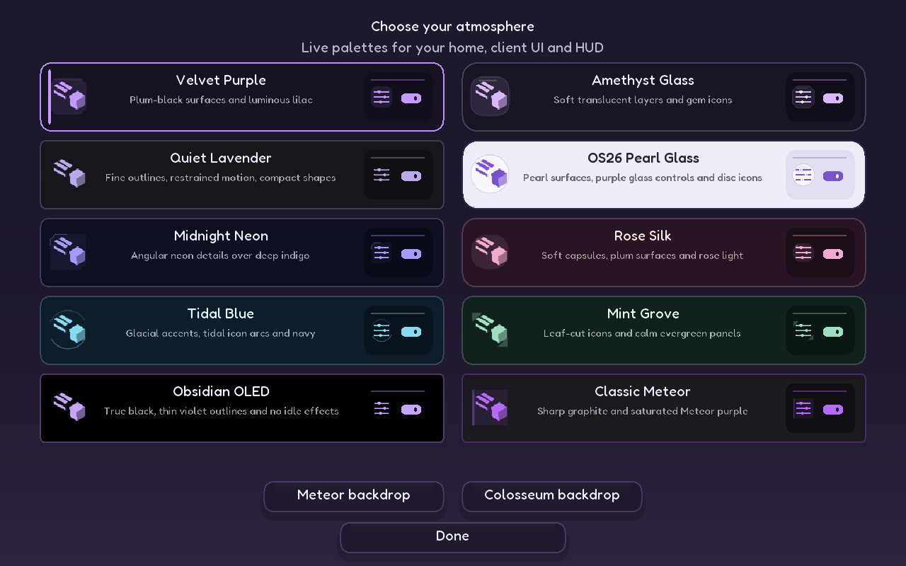
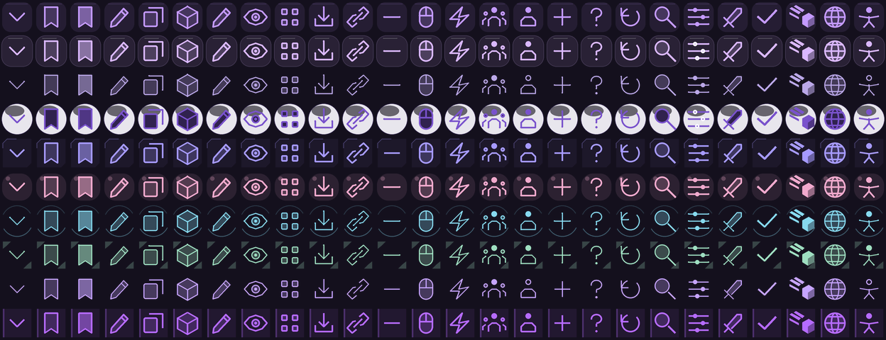

# Meteor Purple Edition v1.5.0 · Zenith

A complete redesign of the classic Meteor interface: floating category windows, crisp purple surfaces, readable rounded typography, animated controls and ten original icon families. The main menu keeps familiar Minecraft actions beneath an animated Meteor mark. Right Shift still opens category windows; there is no replacement hub.

## Download

[Download v1.5.0](https://github.com/davyduao-hue/Meteor-Purple-Edition/releases/tag/v1.5.0). Replace the previous Purple JAR with **meteor-purple-edition-1.5.0.jar**.

Minecraft Java **26.2**, Java **25**, Fabric Loader **0.19.3+**. Official Meteor 26.2-35, Catppuccin 2.4.0+mc26.2 and Fabric API 0.154.2+26.2 are bundled. Remove duplicate standalone copies of those bundled mods. Java, Fabric Loader and Minecraft are installed separately.

## The client interface

- Category windows wrap within the viewport and have bounded, independently scrollable bodies. Native drag positions, collapse behavior and module/settings storage remain in use.
- Module rows show a compact state switch, a colored active edge, spring hover feedback and immediate native left/right-click actions.
- Setting switches stretch and settle, sliders have a responsive thumb while showing the exact native value, dropdown arrows ease into place, text fields have an animated focus outline, and tab selection follows a spring.
- The navigation bar adapts to available width, using recognizable icons and tooltips when labels do not fit. Search, Themes and Motion are available in a bottom dock.
- Bundled Fredoka Medium gives the UI a consistent, readable rounded voice. **zenith-typeface** can be turned off to use Meteor's existing font choice; the global font preference is preserved.
- **custom-client-ui** turns the redesign off and selects the native Meteor theme. Other addons keep their modules and actual setting widgets.

The native Meteor/Catppuccin theme APIs, input handlers, search, keyboard editing, dropdown callbacks, module permissions and persistence remain responsible for behavior. No duplicate settings model is introduced.

## Ten rebuilt themes

Each theme has its own palette, corner treatment and 26 custom symbols. Assets are original code-drawn geometry, packed in ten small atlases; their generator is included. They are not recolored copies of a third-party icon package.

| Theme | Appearance and icons |
| --- | --- |
| Velvet Purple | Plum-black surfaces, luminous lilac, rounded duotone tiles |
| Amethyst Glass | Translucent panels, soft gem tiles and bright edges |
| Quiet Lavender | Compact shapes and fine outline symbols |
| OS26 Pearl Glass | Pearl panels, purple controls and glass disc symbols |
| Midnight Neon | Deep indigo, angular neon icon frames |
| Rose Silk | Plum, soft rose capsules and rounded icons |
| Tidal Blue | Navy, glacial blue, tidal icon arcs |
| Mint Grove | Evergreen, mint and leaf-cut icon details |
| Obsidian OLED | True black, thin violet symbols, no idle motion |
| Classic Meteor | Sharp graphite and saturated purple, pixel-frame symbols |

**Themes** opens live miniature previews of the actual icon, window and control designs. The default backdrop remains the Meteor logo. The real Minecraft colosseum panorama is optional and loads only when selected; switching back releases its extra cubemap image. No live world or shader pack runs behind the menu. [Panorama capture tools](tools/panorama-studio) remain included.

## Menu, logo and loading

The Meteor logo assembles from its seven faces, floats above a softly lit halo, follows the pointer gently, catches a short light sweep and responds to a click with a spring and expanding ring. Its entrance starts when loading uncovers the menu. Buttons arrive in sequence with hover lift, short sheen, underline growth, bounded sparks and click compression. Native world selection, multiplayer/Realms checks, friends, language, accessibility and narration remain intact. Disabling custom-main-menu returns the native title screen.

Resource and world loading show **Zenith Client** / **the client for the elite**, in the bundled rounded typeface. The bar follows real progress, with a spring, gloss, a bright cap, a small impact response and fixed spark slots. Actual percentages, native completion/errors, world readiness and fades remain authoritative; loading is never held for an animation.

## Motion and performance controls

Open **Motion** from the menu or client dock, or **Purple → Purple Appearance**:

- **Gentle**, **Playful** and **Arcade** change the strength of the feedback. Playful is the default.
- **ui-particles** disables motes and bursts separately.
- **ui-animations** controls the menu, loading and classic client feedback.
- **in-game-animations** adds Zenith HUD feedback and themed native pause/options controls. It is off by default.
- **reduced-motion** bypasses transitions and spring effects.
- **performance-mode** bypasses motion, particles, decorative shadows and optional blur; it also lowers HUD data refresh from 4 Hz to 2 Hz.

Rounded native menu panels now submit one GUI drawing state per surface, rather than one per pixel strip. Merged corner spans preserve the old pixel coverage with fewer vertices. Idle springs stop integrating, label widths are cached, particles have fixed counts and there is no per-frame file I/O. The panel benchmark in [VALIDATION.md](VALIDATION.md) measures this specific extraction improvement, not a gameplay FPS multiplier.

The Zenith Client/FPS bar and performance panel remain movable, scalable and toggleable in Meteor's HUD editor. Per-metric options and existing saved layouts remain. Optional game UI motion changes presentation only; it does not alter camera movement, player physics, combat timing or hitboxes.

## Addons and building

Glazed 17.2, its nested ExploitPreventer 1.1.0 and OpSec 1.1.7.1 are tested as separate official 26.2 installs. Glazed is not bundled because of its redistribution license. The existing upstream OpSec/EP soft conflict warning is retained, and its recognized compatibility mode is detected without altering either protection engine. See [THIRD_PARTY.md](THIRD_PARTY.md) for sources and licenses.

Run `gradlew.bat build` or `bash gradlew build`, then `python scripts/verify_bundle.py`. Complete pinned corresponding sources are packaged with releases. GitHub Actions builds on Windows and Linux before publishing. The isolated runtime harness is in qa/bundle-smoke. No normal launcher profile or global Windows settings are changed.

## Actual game captures

